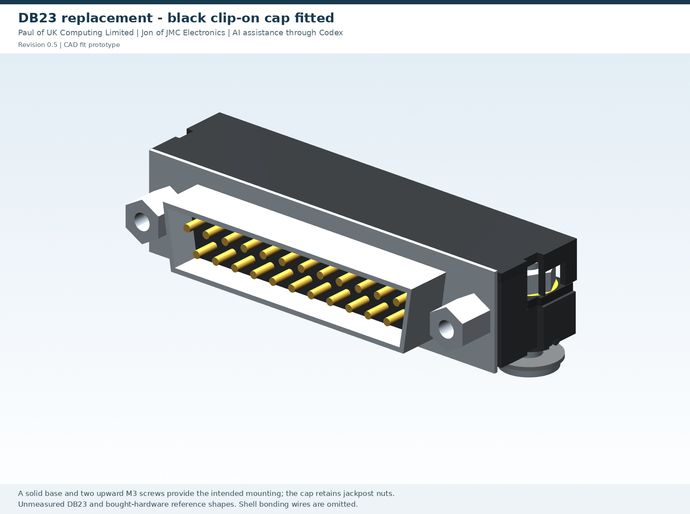
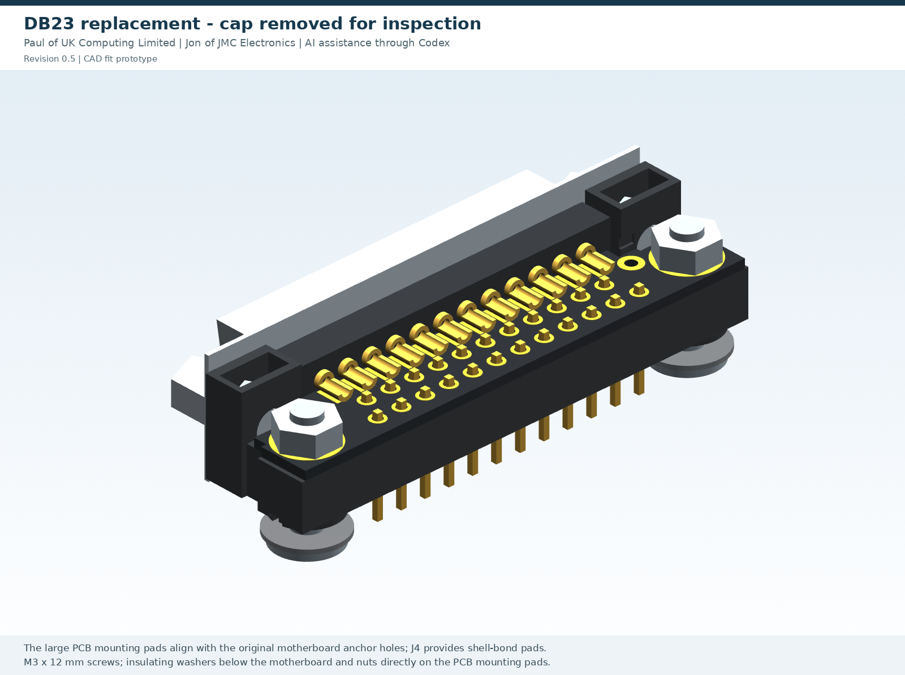
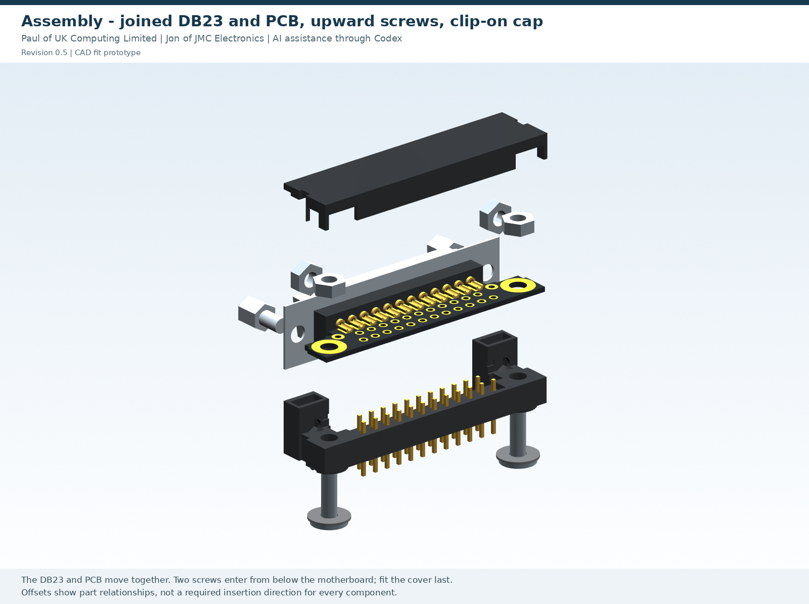
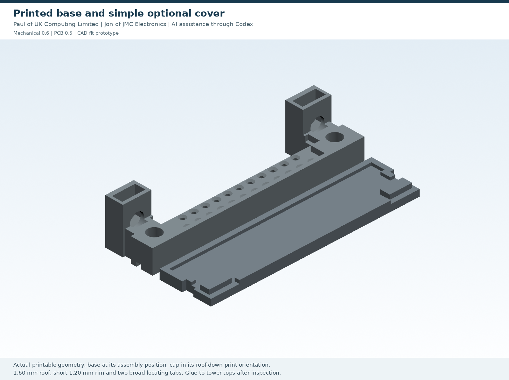

# Amiga DB23 Video and Floppy Replacement

A replacement assembly for the Amiga's motherboard-mounted **DB23 RGB video and external floppy connectors**. A genuine solder-cup DB23 joins a small horizontal PCB, 23 supported straight pins and a solid printed base. Two screws clamp the assembly through the original motherboard mounting holes, with nuts above the adapter PCB and insulating washers under the motherboard-side heads. A keyed black clip-on cap retains the port-jackpost nuts and covers the hardware. **Current PCB, assembly and mechanical revision: 0.5.**

Project development: **Paul of UK Computing Limited**, **Jon of JMC Electronics** and **AI assistance through Codex**. This develops Paul's supplied straddle-PCB concept and supported loose-pin construction.

Repository: [HoodPaul/amiga-db23-alternative](https://github.com/HoodPaul/amiga-db23-alternative).

**Status, 29 October 2026: fit prototype. The chosen solder-cup connector, fasteners, printer tolerances and installed fit have not been measured. No physical strength, assembled electrical operation or Amiga compatibility test has been completed.** Native files and trial prints make those checks possible; this is not a production release.

For engineering or AI work, read [AGENTS.md](AGENTS.md), the [handover](docs/AI-HANDOVER.md) and [documentation index](docs/README.md).






The printed geometry comes from the delivered CAD. Bought connector bodies, cups, pins and hardware are unmeasured reference envelopes. Their appearance does not prove a purchased part fits. See the [drawing PDF](previews/DB23_Prototype_Drawings_v0.5.pdf) for fit references and assembly views.

## Revision 0.5 arrangement

The DB23 cups straddle the front of the PCB: contacts 1–12 solder to the top and 13–23 to the bottom. Twenty-three separate pins pass through the base into the original motherboard signal holes.

The shorter PCB has side ears with plated `SHIELD` mounting lands at the original shell-anchor positions. **M3 screws enter from underneath the motherboard**, pass through the solid base and PCB, and take nuts on top, with insulating washers beneath the screw heads. Flat bosses support the PCB directly beneath the nuts. Integral mounting feet replace the former loose shims.

Following the marked review, the forward tower sides are squared off to a uniform X±25.60 face. The former rear-corner rebates gain 0.60 mm of material, while the remaining neighbour clearance starts behind the towers.

Dedicated J4 shell-bond pads keep wire and solder away from the J3 nut-bearing lands. The cap fits last, after mounting and inspection. It provides nut retention and the discreet black appearance; the solid base and through-bolts carry the intended cable loads. Actual insertion strength and clamping behaviour remain untested.

The build order follows four parts: **join DB23 and PCB; load pins with the separate height jig and solder the joined assembly onto them; fit jackpost nuts and posts; mount and solder to the motherboard, inspect, then fit the cap.** See the [assembly guide](docs/ASSEMBLY.md).

## PCB variants

Open the matching project with **KiCad 7.0 or newer**:

| Variant | Native project | Connector on the Amiga |
|---|---|---|
| RGB video | [DB23M_RGB.kicad_pro](pcb/DB23M_RGB/DB23M_RGB.kicad_pro) | Male DB23 solder-cup connector |
| External floppy | [DB23F_Floppy.kicad_pro](pcb/DB23F_Floppy/DB23F_Floppy.kicad_pro) | Female DB23 solder-cup connector |

Local symbols and footprints are included. Male and female pin numbering is mirrored; use the matching PCB.

| PCB property | Revision 0.5 |
|---|---|
| Overall board envelope | **51.20 × 9.00 mm**, Y4.00–13.00, with mounting ears, front clearance steps and local reliefs |
| Layers / assumed thickness | **Two / 1.00 mm**; confirm the actual cup gap |
| Proposed finish | Black mask, white silkscreen, ENIG exposed pads |
| PCB legend, both faces | **Amiga DB23 REV 0.5**, nominal 0.70 mm text height / 0.10 mm stroke |
| Signal track / clearance | **0.50 / 0.20 mm** |
| Tail drill / pad | **1.04 / 1.70 mm** |
| J3 mounting drill / pad | **3.30 / 6.50 mm** |
| J4 shell-wire drill / pad | **1.20 / 2.40 mm** |
| Along-row pitch / spacing / stagger | **2.77 / 2.84 / 1.385 mm** |
| Front / rear signal rows | **Y8.08 / Y10.92 mm** from flange datum |
| Shell mounting centres | **44.27 mm**, at **Y9.50 mm** |
| Nominal mating centreline | **6.25 mm** above the motherboard |

The hole pattern and mating references are nominal values from the [iComp OEM-equivalent drawings](docs/SOURCES.md). The PCB rear is now Y13.00 rather than Y16.00, 3.00 mm shorter than revision 0.4. The cap reaches Y13.20, 0.70 mm behind the OEM reference rear at Y12.50. The prints are 52.00 mm wide, but the pair of Ø8 underside washers spans 52.27 mm. Actual side-exiting wire and case/component clearance still need checking on the target motherboard.

## Printed parts and mounting hardware

The [mechanical folder](mechanical/) contains editable OpenSCAD and the following trial parts:

- [Solid base STL](mechanical/DB23_Holder_v0.5.stl) and [STEP](mechanical/DB23_Holder_v0.5.step).
- [Keyed cap STL](mechanical/DB23_Cap_v0.5.stl) and [STEP](mechanical/DB23_Cap_v0.5.step).
- [Pin-height jig](mechanical/DB23_Pin_Height_Jig_v0.5.stl) and [hole-fit coupon](mechanical/DB23_Hole_Fit_Coupon_v0.5.stl).
- [Clip-fit base coupon](mechanical/DB23_Clip_Fit_Base_v0.5.stl) and [matching cap coupon](mechanical/DB23_Clip_Fit_Cap_v0.5.stl).

Read [mechanical notes](docs/MECHANICAL.md) and `mechanical/MECHANICAL_NOTES.txt` for orientations and fit allowances. The cap STL is already roof-down for printing; its STEP uses assembly coordinates. The base underside is stepped: only the mounting feet reach Z0, so local underside supports or a verified bridging process are needed.

The default guides are nominally **Ø0.92 mm** for assumed **0.64 mm square pins**. Their diagonal is about **0.905 mm**, so a finished Ø0.80 mm round bore is too small. Establish snug pin retention using the coupon and actual pins. The loading jig sets a common lower-tip stop; equal upper heights also need equal pin lengths. Remove the jig before soldering.

The default motherboard fastener is **M3 × 12 mm under-head length**, with a user-listed **Ø7 mm, approximately 1 mm thick head**. Fit a **Ø8 mm insulating washer, assumed 0.50 mm thick, beneath each head**; the top nut bears directly on its supported J3 land. With an assumed 1.60 mm motherboard and 2.40 mm nut, the stack takes 11.25 mm, leaving 0.75 mm beyond the nut. The screw tip is Z9.90 and the head bottom Z−3.10, 1.50 mm beneath the assumed motherboard underside. Measure the real stack and underside/chassis clearance. **14 and 16 mm screws require trimming or separately checked cap clearance.** A top washer is not part of the default stack and needs a separate length check. No motherboard countersinking or drilling is specified.

Port jackposts need **4-40 UNC cable-facing threads** and rear stems matching the captive nuts. Prototype defaults use M3 rear stems and nuts. The clearance passage ends at Y6.20; the conservative permitted stem end is **Y≤6.00 from the flange datum**, before the upward mounting nuts. Select the actual hardware before freezing the print.

## Electrical arrangement and validation

All **23 positions pass independently, pin n to pin n**, using neutral `P01`–`P23` names. The bare PCB keeps `SHIELD` separate from every signal pin, including video pin 13. It adds no buffering, conversion, protection or change to the Amiga interface.

J3 mounting lands and J4 shell-wire pads share `SHIELD`. Provide deliberate wires or metal bonds from the DB23 shell and from J4 to the original motherboard shell-ground pad. The default head washers are insulating, and mounting-bolt contact is not relied upon for motherboard grounding. Plastic provides no grounding.

Use the [current validation record](docs/VALIDATION.md) for actual native DRC, exact-netlist and independent geometry results. Native schematic ERC is not claimed. CAD checks do not establish physical fit, printed strength, heat tolerance or working hardware.

Run the portable PCB audit from the project root:

```sh
python3 source/verify_pcb.py
```

Complete the [measurements](docs/MEASUREMENTS.md) and trial prints before a board order. Generated files under [fabrication/FIT-PROTOTYPE/](fabrication/FIT-PROTOTYPE/) are coordinated prototype exports, not a measured production release.

## Project contents

| Path | Purpose |
|---|---|
| [pcb/](pcb/) | Both KiCad projects and local libraries |
| [mechanical/](mechanical/) | Editable source, print trials and STEP geometry |
| [previews/](previews/) | Assembly, print and PCB views, drawing PDF |
| [docs/](docs/) | Assembly, measurements, design decisions and handover |
| [source/](source/) | Shared parameters, builders and verifiers |
| [verification/](verification/) | Actual native and saved-file reports |
| [BOM.csv](BOM.csv) | Parts and selection assumptions |
| [CHANGELOG.md](CHANGELOG.md) | Revision history |
| [NOTICE.md](NOTICE.md) | Project and third-party notices |
